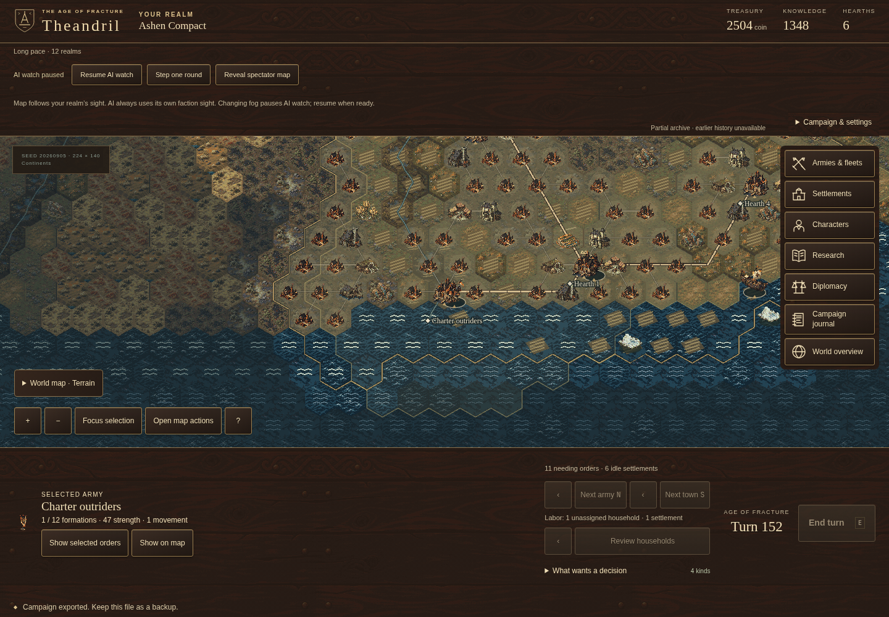

# When a home patrol loses its hearth

## Identity and publication boundary

- Stable draft slug: `patrol-retirement`.
- Publication state: **draft, local and uncommitted**. This continuation is not part of deployed revision `04d1776`. No public catalogue entry or image has been added.
- Source revision: pending the reviewed implementation commit. Current candidate sources are [patrol-recovery.ts](../../packages/ai/src/patrol-recovery.ts) and [patrols.ts](../../packages/ai/src/patrols.ts). The [browser review](../development/2026-10-24-patrol-retirement/browser-review.md) pins its exact earlier source bytes; the [policy review](../development/2026-10-24-patrol-retirement/policy-review.md) records the subsequent comment-only clarification and current recovery hash `e4adc2d2f0323db4a38eb62a4cf6b77e40462bdc5386b4efc2eabf8d1bd97dc2`.
- Rules/save remain **35**; content remains **`015468d1`**. Canonical command semantics, save schemas and pace prices are unchanged.
- Existing scope: **ACT-32/M3**, delegated army orders. No new gameplay scope is added. DH-021, project counterplay and all fifteen release gates remain open.

The [final source manifest](../development/2026-10-24-patrol-retirement/source-hashes.json) pins 17 current source files; all hashes were checked against the files. The [scoped factual review](../development/2026-10-24-patrol-retirement/final-review.md) records the completed checks and retained limitations.

## A company with nowhere to patrol

A home patrol can lose its purpose when another realm captures one of its hearths. In a retained Long campaign, the Wardhall Remnant's Oath guard was still assigned to a two-hearth circuit after the Ashen Compact took its destination. Wardhall could see the new owner, and the other hearth remained Wardhall's. Travel had paused. The enabled patrol continued reserving the company, while safe patrol recovery correctly refused to march it into a hostile settlement.

The local candidate lets an AI-controlled realm retire that narrow obsolete circuit through the ordinary **clear patrol** command. Clearing preserves the current travel order. The company remains reserved for the rest of that AI proposal batch, then a fresh observation can make it available for another task. Any independent theater assignment continues to reserve it.

The change does not require the company to have movement or supply: removing a future circuit does not march it anywhere. It applies only to an enabled persistent circuit between hearths at most six hexes apart, an owned combat land army ashore, a matching paused single travel leg, a currently visible foreign target hearth, and another endpoint that is still owned. Disabled policies, explicit pause-on-war policies, postings, sieges, stationary missions and different or multiple-waypoint travel retain their priority. Hidden or missing ownership facts cannot justify cleanup.

There is no saved marker identifying who authored a patrol. An identical manually configured circuit can therefore receive the same review when the player explicitly hands that realm to AI. Ordinary player-controlled turns do not clear it automatically.

## The company moves again

The production browser journey imports the genuine turn-150 campaign save and uses public Watch controls to step two full rounds. Wardhall clears Oath guard's patrol in the first round. In the next round it issues an ordinary move order, and the company travels from hex 8659 to 8879. The journey injects no player movement and uses no development hooks.

The [recorded commands and rounds](../development/2026-10-24-patrol-retirement/browser-results/production-patrol-retireme-17ca2-ubsequent-ordinary-movement/production-watch-patrol-retirement.json) retain `clearPatrol` at sequence 47, turn 150, followed by `moveTo` at sequence 156, turn 151. The second round completes at turn 152 with hash `968ad111`. All **179 records** replay exactly, and manual save/reload retains the complete archive and state. Coverage begins at the imported save: this is not a replay of the campaign's earlier 150 turns. Importing that mid-round save starts a new full Watch round rather than reconstructing the original earlier round.

*Candidate illustration: the real production browser branch after two Watch rounds. The visible realm is the Ashen Compact observer; the archive proves Wardhall's orders. The picture does not show Wardhall's foreign order controls or establish a broader release gate.*

The linked PNG is the original 1440×1000 viewport capture, with no crop, scaling or re-encoding. SHA-256: `bf7790cdf5c07e35aeb8f056a3bc536df5433e1f925437ba5a7165d8e6834f6b`. Its final pixels were inspected. The [browser review](../development/2026-10-24-patrol-retirement/browser-review.md) retains capture commands, source hashes, save hashes and the other inspected captures. A public image path and publication provenance remain pending; no runtime image copy is claimed.

## Verification and implementation notes

The AI consumes permitted observations and submits ordinary commands; `packages/sim` remains the authority. Retirement and safe resume share a maximum of four commands per review with stable rotation. Retirement makes no path query. A lazy index of currently visible observed cells is built only when a candidate has a foreign target; ordinary recovery avoids that extra scan.

The [initial regression log](../development/2026-10-24-patrol-retirement/tests-fail-before.log) contains six expected missing-cleanup failures and ten passing controls before implementation. The [final focused run](../development/2026-10-24-patrol-retirement/tests-final.log) passes **42 tests in three files**, including 24 [retirement tests](../../packages/ai/src/patrol-retirement.test.ts), in 4.29 seconds. The [test review](../development/2026-10-24-patrol-retirement/tests-review.md) distinguishes the genuine saved witness from authored observation contracts for eligibility, visibility, overrides and a 128-policy bounded review. The latter proves fair rotation and a shared limit for mixed cleanup/resume commands; it is not an organically grown 128-patrol campaign.

The first integrated run exposed a test assumption: after the complete initial AI batch, another same-turn plan assigns the released company a real paid arcane survey before movement. The final unit regression retains and executes all those commands, verifies expenditure, ends the turn, observes later movement and checks exact mirror/save/journal replay. The [initial failed assertion](../development/2026-10-24-patrol-retirement/focused-initial.log) remains available. The production browser branch follows ordinary Watch round cadence and passed without assertion relaxation.

The [production browser run](../development/2026-10-24-patrol-retirement/browser-first.log) passes three journeys in 19.6 seconds: retirement, earlier patrol recovery and player patrol controls. Retirement takes 9.9 seconds. These overlapping regression checks are not additional full-suite totals. The retirement journey source is [patrol-retirement.spec.ts](../../tests/production/patrol-retirement.spec.ts).

The [full local suite](../development/2026-10-24-patrol-retirement/full-tests.log) passes **2,242 tests across 276 files in 60.78 seconds**. [Typecheck](../development/2026-10-24-patrol-retirement/typecheck.log), [lint](../development/2026-10-24-patrol-retirement/lint.log) and the [final production build](../development/2026-10-24-patrol-retirement/build-final.log) pass. After the comment-only source clarification, the rebuilt **32 HTML/JavaScript/CSS files are byte-identical** to the browser-tested build; the [comparison and hashes](../development/2026-10-24-patrol-retirement/build-byte-comparison.json) resolve that source-byte distinction without claiming another browser run.

The unchanged nine-campaign matrix now finishes with the following results, using a Standard map, twelve realms, rules 35, unchanged prices and seeds 20260905–20260907. The [raw measurement](../development/2026-10-24-patrol-retirement/pacing-final.json) and [comparison with the published policy](../development/2026-10-24-patrol-retirement/pacing-comparison.json) retain hashes, outcomes, commands and separate refusal counts.

| Pace | Seed 20260905 | Seed 20260906 | Seed 20260907 | Headline target |
| --- | ---: | ---: | ---: | --- |
| Standard | 219 | 194 | 201 | About 200 |
| Long | 329 | 309 | 287 | About 300 |
| Epic | 374 | 332 | 327 | 350–400 |

All nine end in prosperity victories and execute between one and five accepted `clearPatrol` commands. There are zero submitted-command refusals and zero automatic theater refusals. Standard seed 20260905 retains **one automatic patrol-route refusal**. This measurement contains no new detailed turn trace that establishes its exact cause or time; the earlier published-policy trace must not be presented as a trace of this candidate.

The original Long seed finishes at 329, seven turns earlier than the published recovery policy's 336, but eighteen later than the retained rules-34 baseline of 311. That historical baseline is earlier evidence, not a fresh run. The other Long seeds finish at 309 and 287, versus 304 and 286 under the published policy. Epic seeds 20260906 and 20260907 move from 278/320 to 332/327 but still finish before the 350–400 target. The original Epic seed remains 374. These are measured outcome changes, not proof that retirement alone explains every intervening decision. **DH-021 remains open.**

All [six isolated planner benchmark cases](../development/2026-10-24-patrol-retirement/retirement-benchmark.json) pass. They use authored Huge/Legendary worlds with 196,608/307,200 explored cells and 1,584/4,031 observed armies, including 128 own paused patrols. Current sight remains restricted despite the fully charted world. The ownership transfer and observer positions are authored and strictly save-validated; these are stress fixtures, not played conquests or organic mature empires.

| World | Visible foreign target | Hidden foreign target | Owned target |
| --- | ---: | ---: | ---: |
| Huge | 1.832 ms | 0.248 ms | 0.264 ms |
| Legendary | 2.794 ms | 0.446 ms | 0.455 ms |

These are absolute planner medians after one warmup and three samples. Visible cases issue four accepted clears with zero path queries, preserve every one of the 128 routes and keep all 128 actors reserved in the current batch; a fresh observation holds 124. Hidden and owned-target controls issue no commands or queries. Zero movement prevents ordinary recovery in the owned-target control. All six retain exact saved bytes and journal replay. Timing excludes setup, observation construction, save/hash work, command execution/replay, complete AI turns, worker transfer and rendering. This measures the cost of the observed-cell scan, not a speedup or a complete scale/performance gate.

The scoped local checks are complete, with pacing limitations retained above. No publication or release acceptance is claimed.

## What the investigation did not establish

The [readiness review](../development/2026-10-24-pacing-readiness/diagnosis.md) found no demonstrated persistent funded-project starvation in the corrected campaigns. A proposed choice between two simultaneously adjacent enemy towns was subsequently [ruled out by canonical town spacing](../development/2026-10-24-pacing-readiness/endpoint-retirement-diagnosis.md#rejected-adjacent-siege-hypothesis), before creating an invalid fixture. Neither hypothesis justifies changing prices or peace policy to force a desired campaign finish.

The captured-hearth witness establishes a concrete delegation defect. It does not explain the entire Long pacing gap or prove that victory projects receive adequate counterplay. Missing, hidden, distant or both-lost patrol endpoints remain outside this conservative retirement policy. Broader escort and coordinated-operation behavior remains unfinished.

## Road to 1.0 and handoff

This advances the existing delegation work and supplies bounded evidence toward [Gate C — AI competency](../../DEFINITION_OF_DONE.md#gate-c--ai-competency) and [Gate E — Save integrity](../../DEFINITION_OF_DONE.md#gate-e--save-integrity). The planner benchmark supplies narrow scale/performance evidence; the completed unchanged pacing matrix retains unresolved campaign-duration results. None of these gates is closed by this slice. [Implementation status](../IMPLEMENTATION_STATUS.md), the [agreed scope](../../GAME_1_0_SCOPE.md) and [release gates](../../DEFINITION_OF_DONE.md) remain canonical.

The local evidence is ready for final integration review, retaining adverse pacing results and benchmark scope. Further policy work should begin from an observed failing state and legal ordinary commands. Before any publication, pin the actual implementation revision, review structured journal content and exact image copies, verify the production-subpath reader, and obtain explicit publication authorization. GitHub Actions, Pages deployment and public readback for this candidate are all pending; the prior `04d1776` publication does not cover it.
